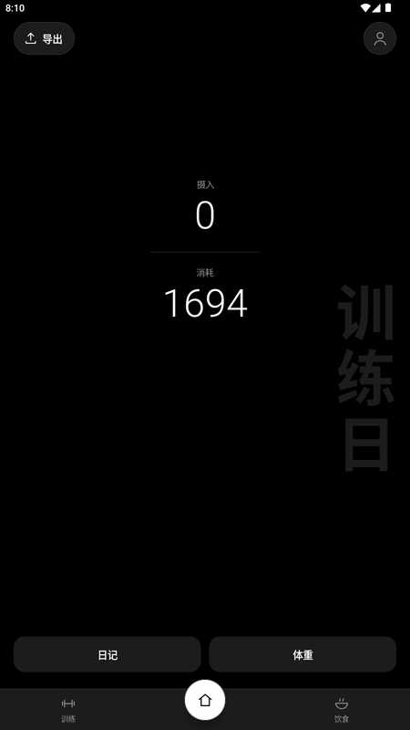
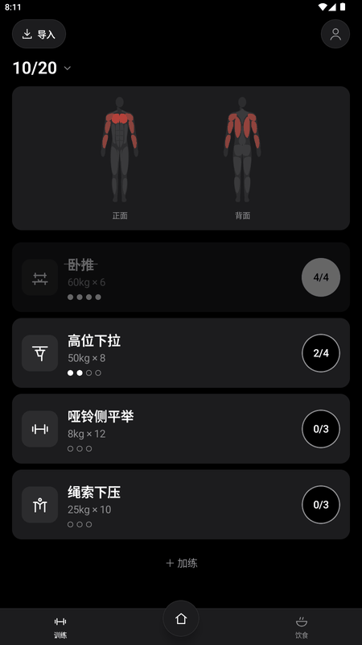
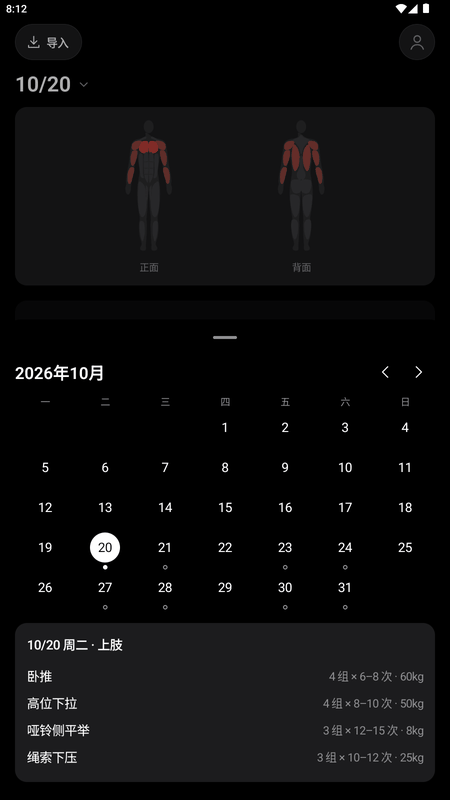
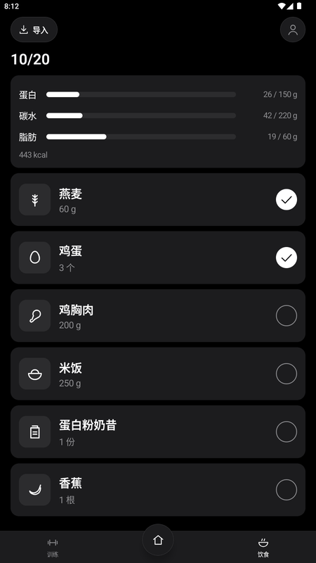

# 薄肌

一个只做「记录」的训练 + 饮食 Android App，为练薄肌设计。

计划不在 App 里生成：先和你自己的 AI 讨论好训练和饮食计划，再导入。数据也不在 App 里分析：导出 JSON，交给你的 AI 去看。App 只负责让每天的执行尽量顺手、安静。

<p>
  
  
  
  
</p>

## 不打扰

- 不发通知，不用闹钟，没有倒计时
- 没有连续打卡、完成率，不显示缺口
- 没完成的项目保持中性，不强调「未完成」

## 功能

**主页**
- 「摄入」「消耗」两个大数字。消耗 = 基础代谢（Mifflin-St Jeor）× 1.2 按时间均匀累加 + 日常活动 + 已完成训练组
- 日记、体重（平滑曲线，可缩放拖动）
- 左上角导出

**训练**
- 点「开始」打卡；点圆形按钮完成一组，长按撤销
- 人体肌肉图：今天练到的部位标红，随完成的组数逐渐加深
- 上次所有组都做到次数上限时，重量旁出现一个很小的 `↑`
- 点动作调整重量 / 次数，看最近几次的最大重量
- 点日期打开日历：查看以后哪天练什么、以前哪天做了什么
- `＋ 加练` 用自然语言记录额外活动（不计入消耗）

**饮食**
- 蛋白 / 碳水 / 脂肪三条进度，打勾即计入
- `＋ 加餐` 自然语言记录（不计入摄入）

**个人页**
- 身高、体重、性别、年龄（每年自动加一）
- 营养目标、震动强度、浅色 / 深色 / 跟随系统
- 从备份恢复、清空数据

## 导入计划

训练页和饮食页左上角「导入」，粘贴 JSON 或从文件选择，可以合并或替换（替换时旧计划归档，历史记录保留）。

想让 AI 帮你写导入文件，把 [docs/IMPORT_FOR_AI.md](docs/IMPORT_FOR_AI.md) 整个发给它即可，里面有完整格式、字段说明和示例。最小示例见 [docs/samples](docs/samples)。

## 安装

在 [Releases](https://github.com/arisuntorch/baoji/releases) 下载 `baoji-*.apk`，在手机上打开安装（需要允许「安装未知来源应用」）。要求 Android 8.0 及以上。

## 构建

需要 JDK 17 和 Android SDK 35。

```bash
./gradlew :app:assembleDebug
```

```bash
./gradlew :app:testDebugUnitTest
```

正式签名：在仓库根目录建一个 `keystore.properties`（已被 git 忽略）：

```properties
storeFile=/path/to/release.jks
storePassword=...
keyAlias=...
keyPassword=...
```

然后运行 `./gradlew :app:assembleRelease`。没有这个文件时 release 包不签名。

技术栈：Kotlin、Jetpack Compose、Hilt、Room、DataStore、kotlinx.serialization。设计细节见 [docs/PLAN.md](docs/PLAN.md)。
